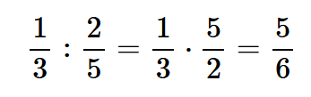

# Bruch-Rechner mit Java, Demo für Debugger von Eclipse #

 

Beispielprojekt für Demonstration Debugger von Eclipse.

Fehler ist in Methode `multiplizieren(Bruch)`.

Quellcode-Vorlage: Übungsblatt 9 (P) von "Einführung in die Programmierung" an DHBW

 

## Beispielrechnung ##

Diese Berechnung wird von der im Projekt enthaltenen `main`-Methode durchgeführt.

 